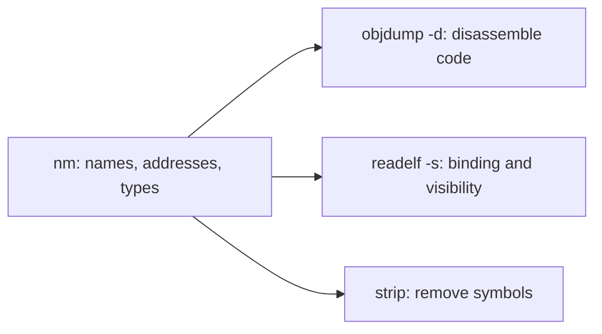

# nm and binary symbols

> Sources: Can Özkan (Medium), 2025-10-30
> Raw: [exploring-nm-tool-symbols-binaries](../../raw/binutils/2025-10-30-exploring-nm-tool-symbols-binaries.md)
> Updated: 2026-10-09

## Overview

`nm` (GNU Binutils) inspects the symbol table of object files, static/shared libraries, and executables — revealing function and variable names with their addresses and types. It is the first tool to reach for on undefined-reference link errors, and a staple of reverse-engineering and binary-analysis workflows.

## Reading nm output

Syntax:

```bash
nm [options] <object-file>
```

Each output line has three columns:

1. Address: The memory address or offset of the symbol within the file. Blank for symbols defined elsewhere, since the linker will resolve them later.
2. Type: A single character indicating the symbol type (for example, whether it's a function, variable, or undefined reference).
3. Name: The name of the symbol itself (usually the function or variable name).

## Symbol types

The middle-column letter names the section or role. Case encodes scope: Uppercase indicates global scope, while lowercase represents local scope.

| Letter | Meaning |
|--------|---------|
| `T` | globally visible function in the text section — indicating it's a globally visible function located in the text section |
| `t` | local (static) function — showing it's a local (static) function |
| `D` | initialized global variable in the data section — meaning it's a defined, initialized global variable stored in the data section |
| `b` | local uninitialized variable in BSS — which means it's a local uninitialized variable (residing in the BSS section) |
| `U` | undefined here — meaning it's undefined in this file and must be resolved by linking against the standard C library |
| `W` / `w` | weak symbol — These symbols allow multiple definitions of the same name, where one definition can override another (e.g. a library fallback a user can override with a stronger definition) |

## Useful flags

- `-D`: show the dynamic symbol table (`.dynsym`), which lists only the symbols needed at runtime for dynamic linking. To view these, you can use the -D option. Default output reads the static table (`.symtab`).
- `-C`: demangle C++ names — This option tells nm to decode mangled names back into their original form, e.g. `nm -C main.o` turns `_Z3addii` back into `add(int, int)`.
- `-n`: sort by address, handy for locating a function before disassembling it (`nm -n hello`, then `objdump -d hello`).

## Stripped vs unstripped

An unstripped binary keeps its symbol table and debug info, so `nm` shows names, addresses, and sections. A stripped binary (`strip hello`) has that metadata removed: it runs identically but is smaller and harder to analyze — `nm` output goes from real names to bare addresses.

```bash
gcc hello.c -o hello
nm hello | head
strip hello
nm hello | head
```

## Practical scenarios

- **Link errors**: for `undefined reference to foo_function`, compare objects — U in a.o means foo() is undefined in that file, while T in b.o means foo() is defined there, confirming that linking both objects resolves it.
- **Reverse engineering**: on an unstripped ELF binary, `T` names like `authenticate_user` reveal purpose immediately, while `U` entries (e.g. `printf`) map external dependencies.
- **Library inspection**: `nm -D /usr/lib/x86_64-linux-gnu/libm.so.6 | grep cos` verifies which cosine variants the shared math library exports before you link against it.
- **Scripted auditing**: plain-text output composes with shell pipelines — e.g. listing undefined symbols across objects, or flagging sensitive functions like `system`/`execve` in a build.

## Companion tools

- `objdump -d`: disassemble the code `nm` names.
- `readelf -s`: fuller symbol attributes (binding, visibility) beside `nm`'s concise letters.


